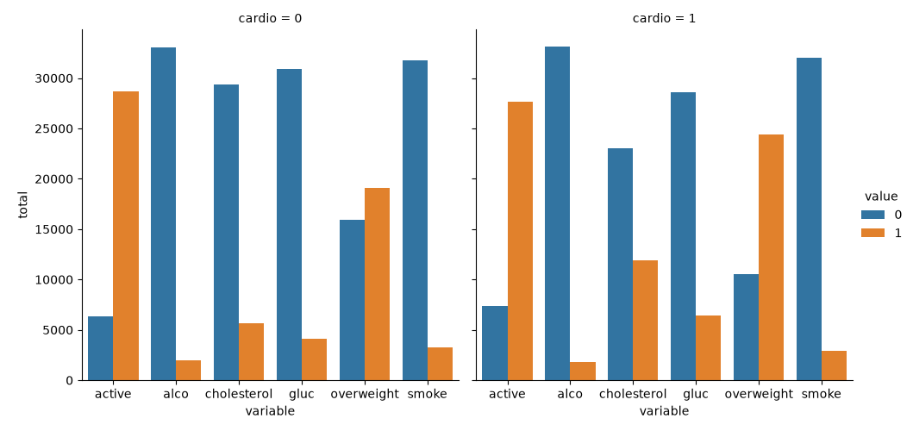
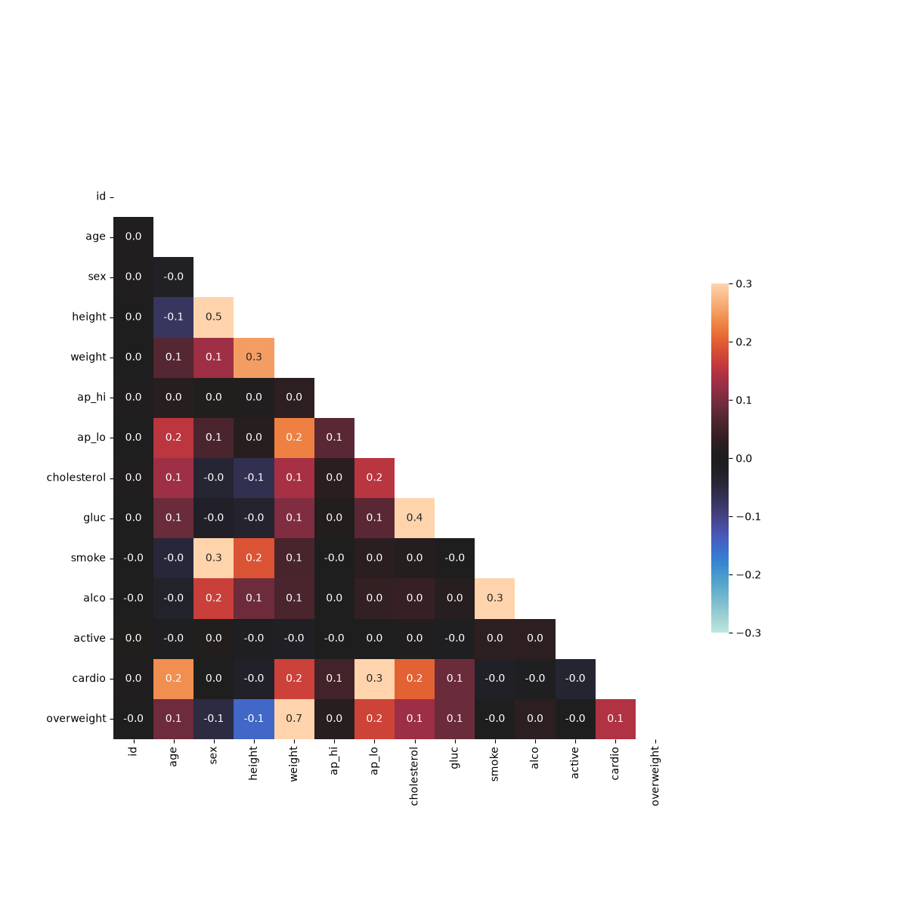

# Medical Data Visualizer

A Python data analysis project that explores relationships between cardiovascular disease, body measurements, medical examination results, and lifestyle habits using Pandas, Matplotlib, and Seaborn.

Built as part of the [freeCodeCamp Data Analysis with Python Certification](https://www.freecodecamp.org/learn/data-analysis-with-python/data-analysis-with-python-projects/medical-data-visualizer).

## Overview

This project analyzes medical examination data to investigate factors associated with cardiovascular disease. It transforms the dataset, calculates additional health indicators, and visualizes patterns using categorical plots and a correlation heatmap.

## Key Features

- Calculate BMI-based overweight status.
- Normalize cholesterol and glucose measurements into binary categories.
- Visualize health indicators by cardiovascular disease status.
- Generate categorical bar charts for cholesterol, glucose, smoking, alcohol intake, physical activity, and overweight status.
- Clean the dataset by filtering invalid blood pressure measurements and extreme height and weight values.
- Calculate correlations between medical and lifestyle variables.
- Generate a heatmap to explore relationships between health indicators.

## Visualizations

### Categorical Plot

Displays counts of health and lifestyle indicators, grouped by cardiovascular disease status.



### Correlation Heatmap

Shows correlations between numerical medical examination and lifestyle variables after data cleaning.



## Tech Stack

- **Language:** Python
- **Data Analysis:** Pandas, NumPy
- **Visualization:** Matplotlib, Seaborn
- **Testing:** Python `unittest`

## Project Structure

```text
medical-data-visualizer/
├── examples/
├── medical_examination.csv
├── medical_data_visualizer.py
├── main.py
├── test_module.py
├── requirements.txt
├── catplot.png
├── heatmap.png
└── README.md
```

## Installation

Clone the repository:

```bash
git clone https://github.com/Sharvesh-k/medical-data-visualizer.git
cd medical-data-visualizer
```

Install the dependencies:

```bash
python -m pip install -r requirements.txt
```

## Run the Project

```bash
python main.py
```

The program generates the categorical plot and correlation heatmap.

## Run Tests

```bash
python -m unittest test_module.py
```

## Learning Outcomes

- Importing and cleaning datasets with Pandas.
- Creating derived columns using conditional calculations.
- Reshaping data with `pandas.melt()`.
- Visualizing categorical data with Seaborn.
- Calculating correlation matrices.
- Creating heatmaps with Matplotlib and Seaborn.
- Testing data visualization functions.

## Acknowledgements

Project challenge provided by [freeCodeCamp](https://www.freecodecamp.org/).

---

**Author:** [Sharvesh-k](https://github.com/Sharvesh-k)
